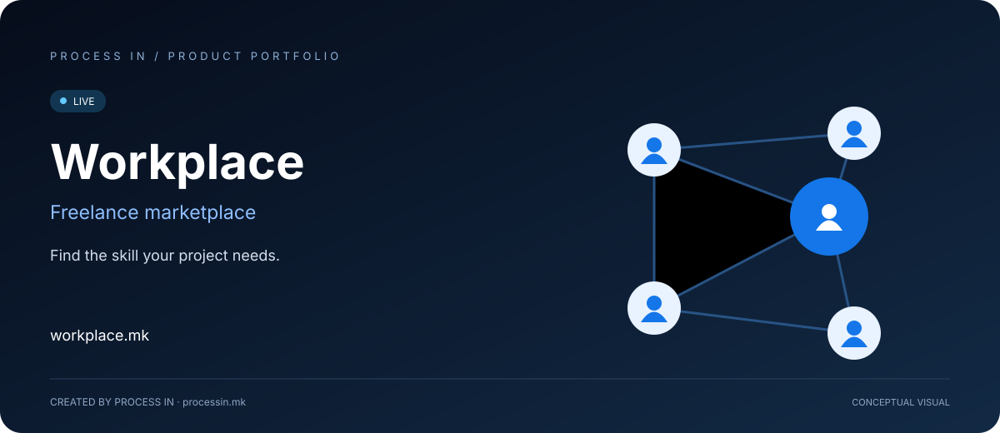

# Workplace

### Вистинската стручност за работата што треба да се заврши.

**Маркетплејс за фриленс услуги и проекти во Македонија.**  
За компании што бараат професионална помош. За фриленсери што ги претвораат вештините во јасна понуда.

[English](README.md) · [Македонски](README.mk.md)

**LIVE**

---

## Workplace и Frilenseri — една платформа, два домена

[workplace.mk](https://workplace.mk) и [frilenseri.mk](https://frilenseri.mk) се два официјални домена за истата платформа. Двата домена се користат за пребарувачка видливост и водат кон истата продуктна понуда. Оваа презентација ги опфаќа двата брендирани пристапа.

## На деловната задача ѝ треба професионалец. На професионалецот му треба начин да биде пронајден.

На компанија може да ѝ треба целна страница, видео за производ, превод или средување табела. Тоа се конкретни задачи, често надвор од секојдневната стручност на тимот. Првиот предизвик е „ни треба помош“ да се претвори во јасно барање, да се најде соодветна услуга и да се разбере што опфаќа понудата.

Фриленсерот ја има другата страна од истиот проблем: вештината треба да биде претставена преку конкретна услуга. Потенцијалниот купувач треба да разбере каква работа се нуди, кој стои зад понудата и дали таа одговара на неговата задача.

**[Workplace](https://workplace.mk/)** ги поврзува овие две страни. Развиен од **[PROCESS IN](https://processin.mk)**, маркетплејсот им овозможува на купувачите да истражуваат услуги и профили, а на фриленсерите да ги претставуваат своите услуги и да откриваат проекти.

Намената е практична: **конкретната работа полесно да се најде, опише и поврзе со соодветна стручност.**

## Два начина да започнеш

<table>
<tr>
<td width="50%" valign="top">

### Пронајди услуга

Започни со резултат што веќе го разбираш: дизајн, превод, програмерска задача или внес на податоци. Разгледај ја категоријата, прочитај ја понудата и провери го профилот на понудувачот.

**Корисно кога:** сакаш да споредиш постојни понуди за дефинирана задача.

[Истражи услуги →](https://workplace.mk/search)

</td>
<td width="50%" valign="top">

### Истражи проекти

Започни од работа што купувач треба да ја заврши. Фриленсерите разгледуваат проекти според своите вештини, наместо да се потпираат само на тоа некој да ја најде нивната услуга.

**Корисно кога:** сакаш да бараш работа според објавената побарувачка.

[Отвори Workplace →](https://workplace.mk/)

</td>
</tr>
</table>

## За компании и купувачи: од потреба до јасно барање

Workplace е наменет за ситуации кога на компанијата ѝ треба стручна помош за конкретен резултат. Овозможува истражување понуди од повеќе области, без секоја задача веднаш да се претвора во одлука за постојано вработување.

| Твојата ситуација | Како да го користиш Workplace | Што да појасниш пред да продолжиш |
|---|---|---|
| Ти треба дизајн за лансирање | Разгледај графика и дизајн и соодветни профили | Материјали, формати, бренд насоки и рок |
| Ти треба работа на веб-страница или апликација | Истражи програмирање и технологија | Постоен систем, точен опфат и очекуван резултат |
| Ти треба содржина за друга публика | Разгледај пишување и превод | Јазик, публика, тон и изворен материјал |
| Ти треба обработка на табели или податоци | Прочитај ги понудите во категоријата Податоци | Влезни датотеки, излезен формат и упатства |
| Ти треба креативна работа за кампања | Истражи видео, аудио, фотографија или маркетинг | Канали, потребни материјали и бриф |

Користи ги актуелните понуди за споредба на достапните понудувачи и опфатот на услугите.

## За фриленсери: претстави ја услугата зад вештината

Workplace им дава на професионалците начин да се претстават преку профил и понуди за услуги. Купувачот може да премине од категорија до конкретна понуда и потоа до лицето што ја нуди услугата.

Добра понуда објаснува што добива купувачот, кои информации се потребни за почеток и кои се границите на работата. Така услугата полесно се проценува отколку преку општо тврдење како „работам маркетинг“ или „правам веб-страници“.

Јавната платформа содржи пристап за понудувачи, пронаоѓање фриленсери и разгледување проекти. Тоа поддржува два пристапа: **да бидеш пронајден преку понудата и да откриваш релевантна работа преку проектите.**

[Започни како понудувач →](https://workplace.mk/start_selling)

## Што обединува маркетплејсот

<table>
<tr>
<td width="50%" valign="top">

### Пронаоѓање услуги
Пребарувањето и категориите му помагаат на купувачот да ја стесни потребата до соодветен тип услуга. Описот на понудата е основа за процена дали вреди да се продолжи.

### Профили на фриленсери
Профилот ја поврзува услугата со понудувачот. Купувачите го разгледуваат професионалецот зад понудата, а фриленсерите го претставуваат својот идентитет и работа.

### Откривање проекти
Проектите овозможуваат друг почеток: од барањето на купувачот кон процена дали твоите вештини одговараат на работата.

</td>
<td width="50%" valign="top">

### Понуди и споредба
Услугите прикажуваат наслов, понудувач и почетна цена. Конкретната понуда треба да се прочита пред почетната цена да се протолкува како цена за целото барање.

### Омилени и избор услуги
Омилените овозможуваат релевантните понуди да се задржат за подоцна. Маркетплејсот има и интерфејс за избор на услуги преку кошничка.

### Насоки и поддршка
Сајтот поврзува водичи за купувачи и фриленсери, информации за оценки, верификација, надоместоци, услови и поддршка. Таму се проверуваат актуелните правила за користење.

</td>
</tr>
</table>

## Професионална работа во различни области

Јавните категории опфаќаат **графика и дизајн, дигитален маркетинг, програмирање и технологија, AI услуги, податоци, пишување и превод, видео и анимација, музика и аудио, фотографија, бизнис, финансии и личен развој и хобија**.

Овој опфат е корисен кога една иницијатива бара повеќе вештини. Лансирање производ, на пример, може да бара дизајн, програмирање и текстови. Секоја задача се истражува во соодветната област, со свој опис и очекуван резултат.

## Практичен пристап за користење на Workplace

| Чекор | Купувач | Фриленсер |
|---|---|---|
| **01 — Дефинирај ја работата** | Наведи резултат, материјали и рок | Одреди ја стручноста и услугата што ја нудиш |
| **02 — Истражи** | Разгледај услуги, категории и профили | Провери го пристапот за понудувачи и проектите |
| **03 — Процени совпаѓање** | Прочитај ја понудата и профилот | Спореди го барањето со твојот вистински опфат |
| **04 — Подготви детали** | Појасни ги барањата пред продолжување | Објасни што е вклучено и што ти треба од купувачот |
| **05 — Продолжи на платформата** | Следи ги актуелните упатства за услугата и сметката | Следи ги упатствата за понудувачи или проекти |

## Зошто маркетплејс за ваква работа?

**Појасен почеток.** Започни со категорија услуга или барање за проект, наместо со неодредено барање „некој да помогне“.

**Поинформирана споредба.** Разгледај ги понудата и профилот заедно. Споредувај конкретен опфат, а не само наслов или почетна цена.

**Место за конкретна професионална работа.** Купувачите истражуваат помош за задача, а фриленсерите претставуваат јасен резултат од својата услуга.

**Локално место за пронаоѓање услуги.** Workplace се обраќа на македонска публика и има јавни јазични опции за македонски, албански и англиски.

## Разгледај го вистинскиот производ

Официјалниот сајт е извор за актуелните услуги, проекти, профили и услови.

**[Истражи услуги](https://workplace.mk/search)** · **[Пронајди фриленсери](https://workplace.mk/sellers)** · **[Стани понудувач](https://workplace.mk/start_selling)** · **[Поддршка](https://workplace.mk/help/contact)**

---

| Производ | Workplace |
|---|---|
| Официјален домен | [workplace.mk](https://workplace.mk/) |
| Категорија | Маркетплејс за фриленс услуги и проекти |
| Статус | LIVE |
| Развиено од | [PROCESS IN](https://processin.mk) |
| Портфолио | [PROCESS IN производи](https://github.com/stambolce/process-in) |

### Имаш работа за завршување? Започни со стручноста што ѝ треба.

**[Истражи Workplace →](https://workplace.mk/)**

---

Јавна презентација на производ. Приватниот изворен код и корисничките податоци не се објавуваат тука.

This platform is a digital product of <a href="https://processin.mk" target="_blank">PROCESS IN</a> · Your Enterprise Software & AI Partner ·  
Hosted on Enterprise Infrastructure by <a href="https://inhost.mk" target="_blank">INHOST</a> ·
